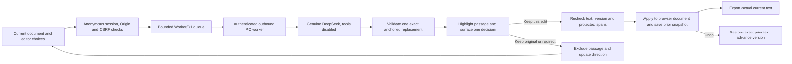

# The page is the workspace

Opening a proof or changing an active editorial direction initiates a suggestion on its own. This is a real model draft staged for human review, not an automatic document write. The interface surfaces one passage and one decision. The editor does not write a prompt or search a metrics dashboard.

`src/contract.js` is shared by server and browser. It bounds document/context size, refuses extra authority fields, verifies the exact unique quote, rejects protected/rejected spans and enforces unchanged numerical tokens. `src/ai.js` passes context as untrusted data and records attempts before calls, so failures consume allowance. `src/cli-client.js` invokes the genuine supported client without tools or saved sessions.

The public Worker owns anonymous session IDs. Only the authenticated PC can claim a queued request. Queued text is cleared after claim, results after response or timeout. The worker does not retry inference after delivery failure. The caller may need to request a fresh reading, but no document mutation occurs on the server. There is no exactly-once billing claim.

The browser holds the writing artifact. Suggestions carry the full input text and version; both are checked again immediately before application. Changing text, protection, direction or undo invalidates older suggestions and increments a request-generation counter, so late responses cannot overwrite a newer context. Undo restores an exact prior document snapshot and advances the monotonic version. It does not repeat inference. Browser storage holds up to 20 undo snapshots; it is not cloud backup.

The numerical/anchoring checks are narrow guarantees. Meaning, attribution, names and editorial voice still require human review. Model text and imported writing are escaped before rendering. Export downloads the actual current reading copy; nothing is published to an external writing service automatically.
