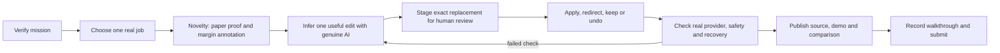

# Imprint methodology map

Mission: [Beyond the Chatbot](https://build.doo.ooo/challenges/beyond-the-chatbot), live brief reviewed October 17, 2026.

Current update: October 25's approved recovery uses Astra and an original repair-table draft. See [recovery evidence](astra-recovery.md). The completion history and literary-source description below document the earlier release and recording.

The job is a copy editor preparing a readable adaptation of a short text. The document is the interface. The system initiates a proposed edit when a proof opens or its editorial direction changes; it does not wait for a conversational instruction. Only one anchored edit and the reason to consider it are surfaced. No chat transcript, metric cards or task dashboard.

Novelty relative to earlier entries: Threshold controls authority; Relay Trust delegates credentials; Pivot adapts execution plans; Recollect manages uncertain memory; Rehearse simulates SQL effects. Imprint performs direct document editing through a paper proof, inline marks and a margin note. Reusing authenticated transport does not reuse their product, domain or UI.

## Gates

1. Live mission and source excerpt verified. Complete.
2. One exact edit, document/version binding, protected wording and reversible history. Complete.
3. Genuine intent inference from document, direction and keep decisions; no model tools or automatic application. Actual local and public HTTP verification complete.
4. Wrong-guess recovery through Keep original, a changed direction, and exact undo; stale/protected/number-changing patches refused. Automated and actual-model HTTP checks pass; public browser apply/export/reload/undo verified.
5. Browser workflow, clean clone, source/credential scan, public Site and repository. Public Site and repository published. Credential scans, public browser workflow, mobile width and clean source run verified. Final video release published.
6. Continuous 90.1-second walkthrough, comparison image, architecture, 174-word thesis and factual notes. Complete and published.
7. Authorized DOO submission with visible saved-entry proof retained locally. Complete October 18, 2026.

The text is real public-domain literary material, not lorem ipsum. It is an editorial adaptation, never represented as Austen's revised original. User imports are held on this browser; generating a suggestion sends the current text and editing context to the approved DeepSeek provider through the operator's PC. No external publication of imported writing occurs automatically.
